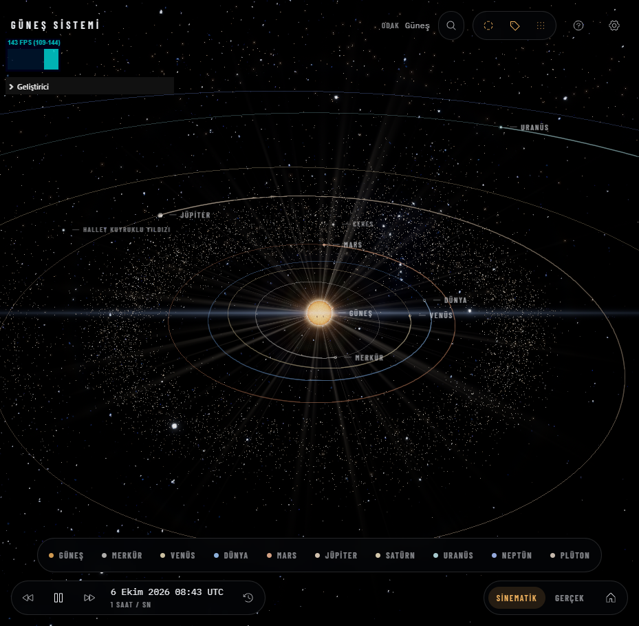
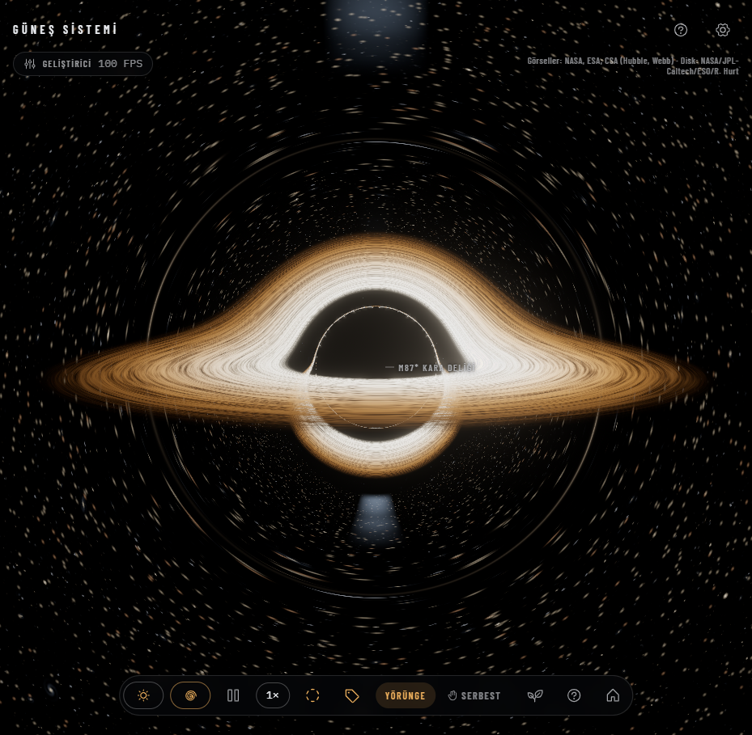

# Space Project

Tarayıcıda çalışan, sinematik kalitede bir 3D evren keşif uygulaması. Güneş'in yüzeyinden başlayıp gezegenlere, Samanyolu'nun merkezindeki kara deliğe ve milyarlarca ışık yılı uzaktaki kuasarlara kadar kesintisiz gezinebilirsiniz. Her şey gerçek verilere ve fiziğe dayanır; görüntüler oyuncak gibi değil, belgesel gibi görünsün diye tasarlandı.





## Öne çıkanlar

### Güneş Sistemi
- **Canlı Güneş**: hareketli plazma yüzeyi, diferansiyel dönme, güneş lekeleri, korona, fışkırmalar ve patlamalar. Tamamı prosedürel shader'larla üretilir.
- **Gerçekçi gezegenler**: 4K dokular, atmosfer saçılması, Dünya'da bulutlar, gece ışıkları ve okyanus yansıması.
- **Gölgeler**: Satürn halkaları gezegene, gezegen halkalara gölge düşürür. Uydu gölgeleri gerçek oranlardadır.
- **Gerçek yörüngeler**: Kepler yörünge elemanlarıyla hesaplanan gezegen, uydu, cüce gezegen ve kuyruklu yıldız konumları. Zaman ileri, geri ve istenen hızda akar.
- **Asteroit ve Kuiper kuşakları**: on binlerce bireysel kaya, GPU üzerinde ilerletilir ve akıcı kalır.
- **Kuyruklu yıldızlar**: Güneş'e yaklaştıkça uzayan toz ve iyon kuyrukları. Halley'in 1986 geçişini tek tıkla izleyebilirsiniz.
- **Galaktik hareket**: Güneş Sistemi'nin galaksi içinde ~248 km/s ile yol alışını izler, gezegenlerin çizdiği sarmal izleri gösterir.
- **Yaşanabilir bölgeler**: Kopparapu (2014) modeline göre hesaplanır.

### Galaksi ve ötesi
- **Samanyolu**: çubuk, şişkinlik ve toz şeritleriyle 3D galaksi modeli; yakın yıldızlar, küresel kümeler ve uydu galaksiler.
- **Kara delikler**: Schwarzschild jeodeziklerini ışın izleme ile çözen, *Interstellar* tarzı kütleçekimsel merceklenme. Sgr A*, M87*, TON 618 ve diğerleri.
- **Derin uzay**: Yengeç Bulutsusu ve pulsarı, Orion, Yaratılış Sütunları, Halka Bulutsusu. Hubble ve Webb görüntülerinden derinlik katmanlarıyla oluşturulmuş hacimli bulutsular.
- **Galaksiler arası**: Andromeda, Sombrero, Centaurus A, 3C 273 gibi 17 nesne gerçek uzaklıklarında.
- **Dev yıldızlar**: UY Scuti, VY Canis Majoris, R136a1 ve WOH G64.
- **Keşfet menüsü**: ~30 hedef, her biri için zengin bilgi kartları.

### Fizik oyun alanı
Güneş Sistemi'ne kara delik, yıldız, pulsar ya da gezegen ekleyip ne olacağını izleyin.
- **N-cisim simülasyonu**: Web Worker içinde uyarlanabilir adımlı leapfrog integratörü.
- **Işık hızında kütleçekim**: yeni bir cismin çekimi ve ışığı her gezegene ancak d/c süre sonra ulaşır.
- **Olaylar**: çarpışma ve birleşme, Roche sınırında parçalanma, spagettileşme, sistemden fırlama, yörünge yakalama.
- **Dünya iklim paneli**: sıcaklık, X-ışını dozu, gelgit kuvvetleri ve atmosfer kaybı canlı olarak hesaplanır.
- **Hazır senaryolar**: Dünya'nın yanından geçen kara delik, TON 618, yakın pulsar ve daha fazlası.

### Kamera ve arayüz
- Tıkla ve uç: van Wijk–Nuij yolu ile yumuşak yakınlaşma ve kaydırma.
- Fare tekerleğiyle gezegenden galaksiye kesintisiz zoom.
- Harita tarzı serbest kamera: imlecin altındaki cismin etrafında döner.
- Arama, klavye kısayolları, katman açma/kapama, uyarlanabilir grafik kalitesi.

## Kurulum

[Node.js](https://nodejs.org/) 20.19 veya üstü gerekir.

```bash
npm install
npm run dev
```

Ardından tarayıcıda `http://localhost:5173` adresini açın.

### Diğer komutlar

| Komut | Açıklama |
|---|---|
| `npm run build` | Tip kontrolü ve üretim derlemesi (`dist/`) |
| `npm run preview` | Derlenmiş sürümü yerelde sunar |
| `npm run typecheck` | Sadece TypeScript kontrolü |
| `npm run data` | Yörünge ve fiziksel verileri JPL'den yeniden indirir |
| `npm run textures` | Yüksek çözünürlüklü kaynak dokulardan 4K sürümleri üretir |

Ham kaynak dosyaları (`assets-src/`) depoya dahil değildir. Uygulamanın çalışması için gereken her şey `public/` altındadır. Kaynakları yeniden üretmek için `scripts/` altındaki indirme betiklerini kullanın.

## Kısayollar

| Tuş | İşlev |
|---|---|
| `0`–`9` | Güneş ve gezegenler |
| `←` `→` | Önceki, sonraki cisim |
| `/` veya `Ctrl+K` | Ara |
| `Boşluk` | Zamanı durdur, başlat |
| `W` `A` `S` `D`, `R` `F` | Serbest uçuş |
| `M` | Serbest kamera |
| `H` | Genel görünüm |
| `Y` `E` `K` | Yörüngeler, etiketler, kuşaklar |
| `G` | Galaktik hareket |
| `B` | Yaşanabilir bölgeler |
| `P` | Fizik oyun alanı |
| `?` | Yardım |
| `Esc` | Geri |

## Teknolojiler

- [Three.js](https://threejs.org/) (WebGL2) ve özel GLSL shader'lar
- [postprocessing](https://github.com/pmndrs/postprocessing): bloom, tone mapping, SMAA, özel kara delik geçişi
- [GSAP](https://gsap.com/): arayüz animasyonları
- [Vite](https://vitejs.dev/) ve TypeScript
- Logaritmik derinlik tamponu ve kayan orijin ile kilometreden gigaparseke kadar ölçek

## Kaynaklar ve lisanslar

Dokular, görüntüler ve bilimsel verilerin kaynakları [docs/CREDITS.md](docs/CREDITS.md) dosyasında listelenir. Gezegen dokuları [Solar System Scope](https://www.solarsystemscope.com/textures/) (CC BY 4.0), galaksi ve derin uzay görüntüleri NASA, ESA, CSA ve ESO kaynaklıdır.
