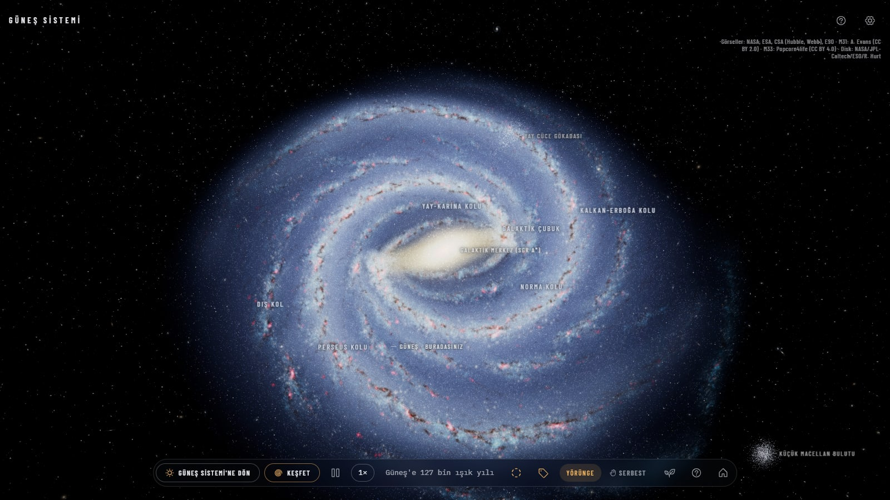
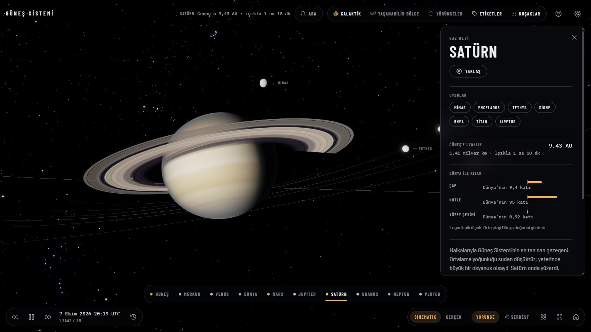
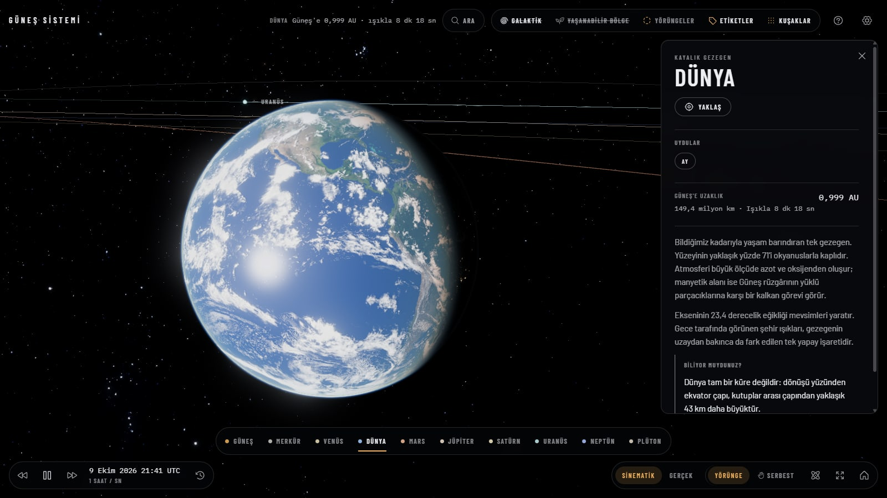
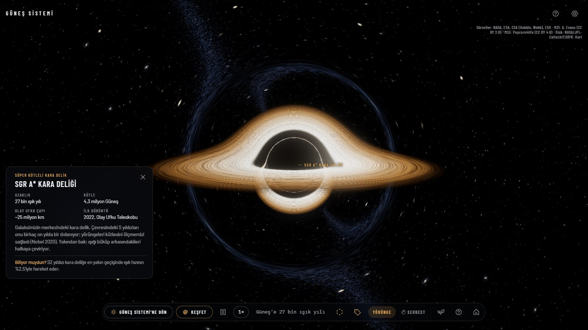
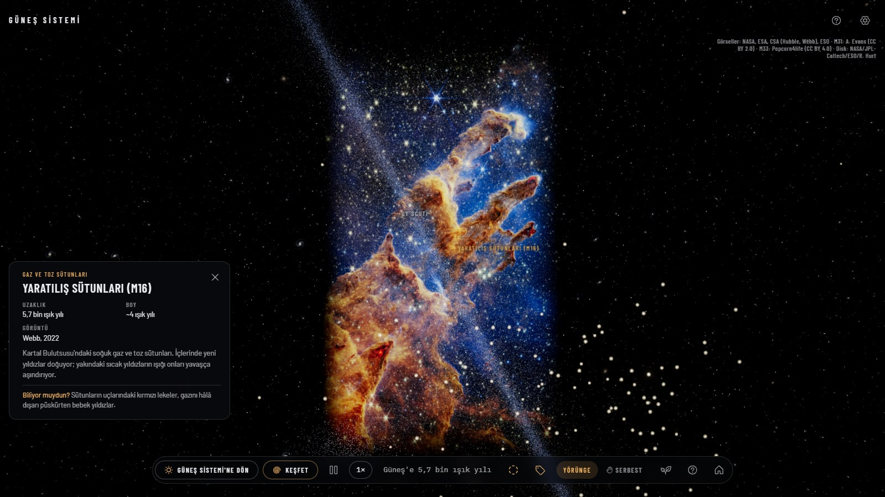
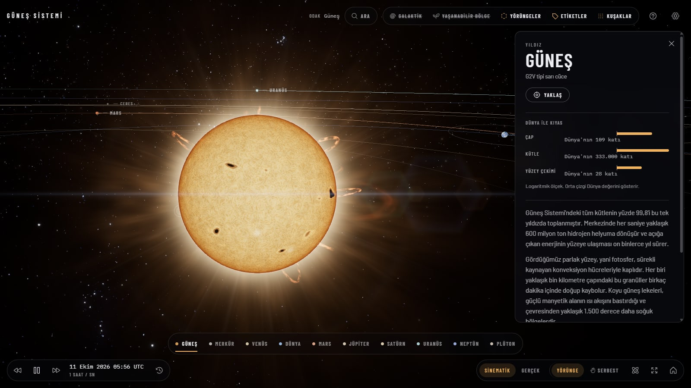
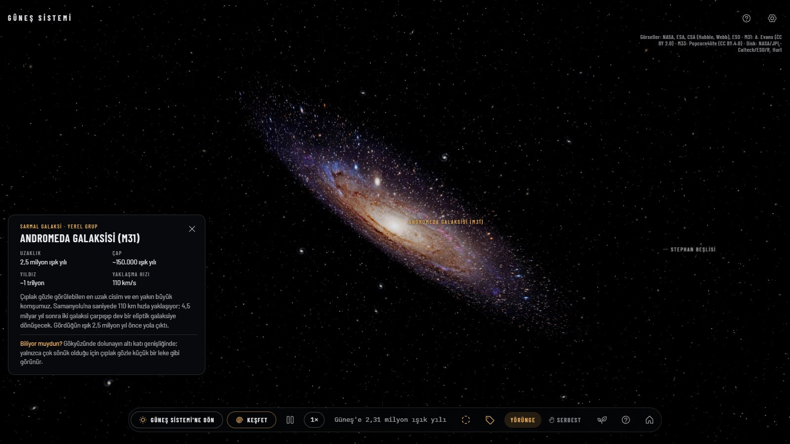
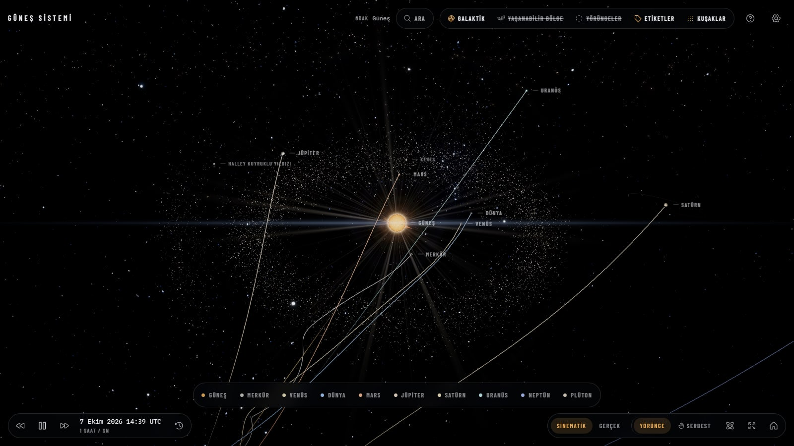
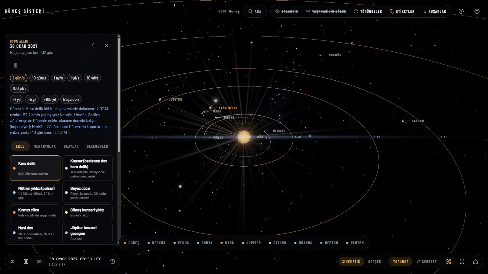
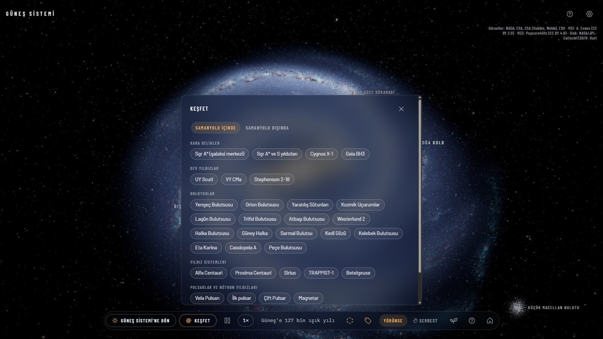

# Space Project

Tarayıcıda çalışan, sinematik kalitede bir 3D evren keşif uygulaması. Güneş'in yüzeyinden başlayıp gezegenlere, Samanyolu'nun merkezindeki kara deliğe ve milyarlarca ışık yılı uzaktaki kuasarlara kadar kesintisiz gezinebilirsiniz. Güneş Sistemi'ne kara delik, pulsar ya da yıldız ekleyip sonucu gerçek fizikle izleyebilirsiniz. Her şey gerçek verilere dayanır; görüntüler oyuncak gibi değil, belgesel gibi görünsün diye tasarlandı.



<table>
  <tr>
    <td></td>
    <td></td>
  </tr>
  <tr>
    <td></td>
    <td></td>
  </tr>
  <tr>
    <td></td>
    <td></td>
  </tr>
  <tr>
    <td></td>
    <td></td>
  </tr>
</table>

## Öne çıkanlar

### Güneş Sistemi
- **Canlı Güneş**: hareketli plazma yüzeyi, diferansiyel dönme, güneş lekeleri, korona, fışkırmalar ve patlamalar. Tamamı prosedürel shader'larla üretilir.
- **Gerçekçi gezegenler**: 4K dokular, atmosfer saçılması, Dünya'da bulutlar, gece şehir ışıkları ve okyanus yansıması.
- **Gölgeler**: Satürn halkaları gezegene, gezegen halkalara gölge düşürür. Uydu gölgeleri gerçek oranlardadır.
- **Gerçek yörüngeler**: gezegen, uydu, cüce gezegen ve kuyruklu yıldız konumları JPL verileri ve Kepler elemanlarıyla hesaplanır. Zaman ileri, geri ve istenen hızda akar.
- **Asteroit ve Kuiper kuşakları**: on binlerce bireysel kaya GPU üzerinde ilerletilir ve akıcı kalır.
- **Kuyruklu yıldızlar**: Güneş'e yaklaştıkça uzayan toz ve iyon kuyrukları. Halley'in 1986 geçişini tek tıkla izleyebilirsiniz.
- **Galaktik hareket**: Güneş Sistemi galaksi içinde ~248 km/s ile yol alır. Gezegenlerin bu hareketle çizdiği sarmal izler gösterilir.
- **Yaşanabilir bölgeler**: Kopparapu (2014) modeliyle hesaplanır. Güneş Sistemi'nde ve galaksideki yıldız sistemlerinde gösterilir.
- **Teleskoplar ve sondalar**: Hubble, James Webb, Chandra, Spitzer, Kepler, TESS, Gaia, Euclid, ISS, Voyager 1–2, Pioneer 10–11, New Horizons, Parker, Juno, Cassini, Europa Clipper ve JUICE, JPL Horizons verisiyle gerçek konumlarında. NASA 3D modelleri, yolculuk izleri, Dünya'dan sinyal gecikmesi (U).
- **Bilgi kartları**: her cisim için Dünya ile kıyas, uzaklık, ışığın yol süresi, uydular ve "Biliyor muydunuz?" notları.

### Samanyolu
- **3D galaksi**: çubuk, şişkinlik, 16 katmanlı disk ve toz şeritleri. Etiketli sarmal kollar, yakın yıldızlar, 150 küresel küme, Macellan Bulutları ve Yay Cüce Gökadası.
- **Kesintisiz geçiş**: Güneş Sistemi'nden fare tekerleğiyle uzaklaşınca galaksi görünümü açılır. Güneş'e dalınca geri dönülür.
- **Keşfet menüsü** (`K`): galaksi içinde ve dışında toplam ~60 hedef, her biri için zengin bilgi kartı.
  - **Kara delikler**: Sgr A* ve çevresindeki S yıldızları (gerçek yörüngeler), Cygnus X-1, Gaia BH3.
  - **Bulutsular**: Yengeç, Orion, Yaratılış Sütunları, Kozmik Uçurumlar, Lagün, Trifid, Atbaşı, Halka, Kedi Gözü, Kelebek, Eta Karina, Cassiopeia A ve daha fazlası. Hubble ve Webb görüntülerinden derinlik katmanlarıyla oluşturulmuş hacimli modeller.
  - **Yıldız sistemleri**: Alfa Centauri, Proxima Centauri ve gezegenleri, Sirius, TRAPPIST-1'in yedi gezegeni, Betelgeuse. Yıldızlar Güneş ile aynı canlı yüzey shader'larıyla çizilir.
  - **Pulsarlar**: Vela, ilk keşfedilen pulsar, Çift Pulsar ve bir magnetar. Dönen ışınlarıyla.
  - **Dev yıldızlar ve kümeler**: UY Scuti, VY Canis Majoris, Stephenson 2-18, Omega Centauri, Ülker.

### Samanyolu'nun ötesi
- **Gerçek uzaklıklarda 17 nesne**: Andromeda, Üçgen, Girdap, Fırıldak, Sombrero, M87, Erboğa A, Puro, NGC 1300, Antenler, Stephan Beşlisi, Araba Tekerleği, Hoag Nesnesi, 3C 273 kuasarı ve Webb'in İlk Derin Alanı.
- **Dev kara delikler**: M87*, M31*, Sombrero*, Erboğa A*, 3C 273, Holmberg 15A* ve 5,6 milyar parsek uzaktaki TON 618.
- **Interstellar tarzı kara delikler**: Schwarzschild jeodeziklerini ışın izleme ile çözen kütleçekimsel merceklenme, ince yığılma diski ve foton halkası.

### Fizik oyun alanı (`P`)
Güneş Sistemi'ne yeni cisimler ekleyip ne olacağını gerçek fizikle izleyin.
- **Eklenebilen cisimler**: kara delik, kuasar, pulsar, beyaz cüce, kırmızı cüce, Güneş benzeri yıldız, mavi dev, Jüpiter ve Dünya benzeri gezegen, haydut gezegen, Ay boyutunda cisim. Sgr A*, M87* ve TON 618 kütleleri tek tıkla seçilir.
- **Yerleştirme**: sahneye tıklayıp hız okunu sürükleyin ya da konum, hız ve kütleyi sayısal formla girin.
- **N-cisim simülasyonu**: Web Worker içinde uyarlanabilir adımlı leapfrog integratörü. Sıkı yörüngeler için evrensel değişkenli Kepler çözücüsü.
- **Işık hızında kütleçekim**: yeni bir cismin çekimi ve ışığı her gezegene ancak d/c süre sonra ulaşır. Yok olan bir cisim, haberi ulaşana kadar çekmeye devam eder.
- **Olaylar**: çarpışma ve birleşme, Roche sınırında parçalanma, gelgitle uzama ve spagettileşme, sistemden fırlama, yörünge yakalama. Parçalanma anında zaman otomatik yavaşlar.
- **Dünya iklim paneli**: sıcaklık, ısıl eylemsizlik, X-ışını dozu, gelgit kuvveti, atmosfer kaybı ve çarpışma enerjisi canlı hesaplanır.
- **Beklenen etki**: her eklemeden sonra çekimin ne zaman ulaşacağı, hangi gezegenlerin koparılacağı ve en yakın geçiş tahmin edilir.
- **11 hazır senaryo**: Dünya'nın dibinden geçen kara delik, 4 ışık yılı uzaktaki TON 618, Kuiper Kuşağı'nda pulsar, Güneş yok olsaydı, Dünya'ya Ay büyüklüğünde çarpma ve daha fazlası.
- **Zaman kontrolü**: 1 gün/s ile 100 yıl/s arası hız, +1, +5 ve +100 yıl atlama, "Bugüne dön".



### Kamera ve arayüz
- **Tıkla ve uç**: van Wijk–Nuij yolu ile yumuşak yakınlaşma ve kaydırma. Varışta kamera hedefin gök kuzeyine hizalanır.
- **Kesintisiz ölçek**: fare tekerleğiyle kilometreden gigaparseke kadar zoom.
- **Serbest kamera** (`M`): imlecin altındaki cismin etrafında döner, boşlukta etrafına bakar, sağ tuşla kaydırır, savrulma momentumu vardır.
- **Serbest uçuş**: `W` `A` `S` `D` ile uzayda uçun.
- **Sinematik ve gerçek ölçek**: gezegen boyutları ile uzaklıklar arasında tek tıkla geçiş.
- **Diğer**: arama, katman açma/kapama, uyarlanabilir grafik kalitesi (Düşük, Orta, Yüksek, Ultra), dokunmatik destek.

## Kurulum

[Node.js](https://nodejs.org/) 20.19 veya üstü gerekir.

```bash
npm install
npm run dev
```

Ardından tarayıcıda `http://localhost:5173` adresini açın. En iyi sonuç için ekran kartı hızlandırması açık bir Chromium tabanlı tarayıcı önerilir.

### Diğer komutlar

| Komut | Açıklama |
|---|---|
| `npm run build` | Tip kontrolü ve üretim derlemesi (`dist/`) |
| `npm run preview` | Derlenmiş sürümü yerelde sunar |
| `npm run typecheck` | Sadece TypeScript kontrolü |
| `npm run data` | Yörünge ve fiziksel verileri JPL'den yeniden indirir |
| `npm run textures` | Yüksek çözünürlüklü kaynak dokulardan 4K sürümleri üretir |
| `npm run hires` | Bulutsu ve galaksilerin orijinal (16K'ya kadar) görüntülerini indirip karolara böler (`public/tiles/`, ~150 MB, git dışı). Çalıştırılmazsa uygulama 4K ile çalışır |
| `npm run spacecraft` | Teleskop ve sondaların yörüngelerini JPL Horizons'tan yeniden indirir |
| `npm run spacecraft:models` | NASA 3D modellerini sadeleştirip `public/models/spacecraft/` altına yazar |

Ham kaynak dosyaları (`assets-src/`) depoya dahil değildir. Uygulamanın çalışması için gereken her şey `public/` altındadır. Kaynakları yeniden üretmek için `scripts/` altındaki indirme betiklerini kullanın.

## Kısayollar

| Tuş | İşlev |
|---|---|
| `0`–`9` | Güneş ve gezegenler |
| `←` `→` | Önceki, sonraki cisim |
| `/` veya `Ctrl+K` | Ara |
| `Boşluk` | Zamanı durdur, başlat |
| `W` `A` `S` `D`, `R` `F` | Serbest uçuş (`Shift` ile hızlı) |
| `M` | Serbest kamera |
| `H` | Genel görünüm |
| `Y` `E` `K` | Yörüngeler, etiketler, kuşaklar |
| `G` | Galaktik hareket |
| `B` | Yaşanabilir bölgeler |
| `P` | Fizik oyun alanı |
| `K` (galakside) | Keşfet menüsü |
| `?` | Yardım |
| `Esc` | Geri |

## Teknolojiler

- [Three.js](https://threejs.org/) (WebGL2) ve 70'ten fazla özel GLSL shader
- [postprocessing](https://github.com/pmndrs/postprocessing): bloom, tone mapping, SMAA, kara delik merceklenme geçişi
- [GSAP](https://gsap.com/): arayüz animasyonları
- [Vite](https://vitejs.dev/) ve TypeScript
- Logaritmik derinlik tamponu ve kayan orijin ile gigaparsek ölçeğinde hassasiyet
- Fizik simülasyonu için Web Worker

## Kaynaklar ve lisanslar

Dokular, görüntüler ve bilimsel verilerin kaynakları [docs/CREDITS.md](docs/CREDITS.md) dosyasında listelenir. Gezegen dokuları [Solar System Scope](https://www.solarsystemscope.com/textures/) (CC BY 4.0), galaksi ve derin uzay görüntüleri NASA, ESA, CSA ve ESO kaynaklıdır.
